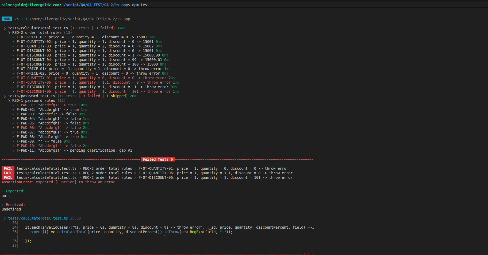
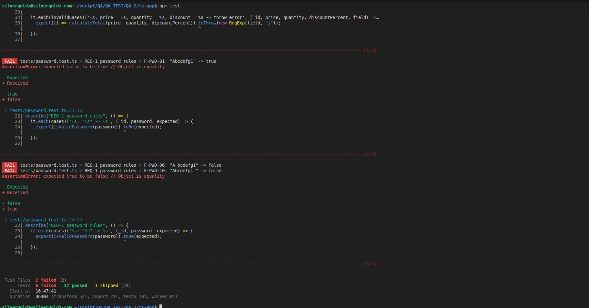

# Typescript automation using vitest
This section is about learning automating test cases for each function from the main app.
Developer is given the code to test each function according to the REQ file (previously from QA_1)

## Summary
There are 2 functions from src/shop.ts: 1) isValidPassword and 2) calculateTotal

## How to run
open QA_2/ts-app as project. 
### To setup project
on terminal, type `npm ci` to install the module I have installed
### To run program
on terminal, type `npm tests`

# Screenshots

